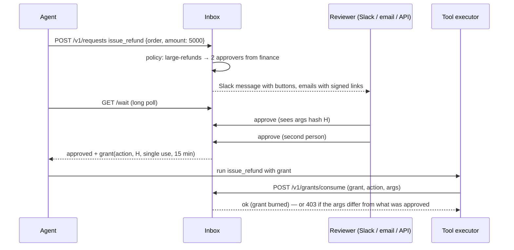

# human-in-the-loop-inbox

[](https://github.com/darshansatpathy/human-in-the-loop-inbox/actions/workflows/ci.yml)
[](https://github.com/darshansatpathy/human-in-the-loop-inbox/actions/workflows/codeql.yml)


An approval inbox for agent actions. A policy decides which actions need a person; reviewers decide in Slack, by email or through the API; and **the agent can only execute exactly what was approved, once**.

> Reference implementation built on synthetic or public data. It distils patterns from production
> work into code you can run and read; it is not a client system.



## Why it is built this way

| Problem | What the inbox does |
|---|---|
| The agent asks for a 50 refund, gets approval, sends 5,000 | Approvals bind to a hash of the action and its exact arguments. The executor consumes a single-use grant and is refused if anything differs. |
| The agent retries and runs the action twice | Grants work once. Submissions take an idempotency key. |
| Someone approves their own request through the agent | Separation of duties: the person a request is on behalf of cannot approve it, and is not asked to. |
| Two clicks at once, or Slack retrying a delivery | Votes lock the request; one vote per person per version of the arguments; one grant per approval. |
| A reviewer changes the amount before approving | Edits are allowed per rule; approvals given for the old arguments stop counting, and a vote on a stale view is refused. |
| Email security scanners "click" links | Email links open a confirmation page; only the POST decides. Links are signed for one reviewer, one request, one decision and the arguments they saw. |
| Slack is down when the request arrives | Notifications go through a transactional outbox with retries, backoff and dead-lettering. |
| Nobody answers | Requests expire; rules can escalate to another group after a set time. |
| "Who approved this?" six months later | Every change is an event in a hash-chained, append-only log; `hitl verify-audit` finds the first altered event. |

Each of these is a test; [`docs/guarantees.md`](docs/guarantees.md) maps them.

## Policy

```yaml
rules:
  - name: small-refunds
    match: {action: issue_refund, args: {amount: {lte: 50}}}
    decision: auto_approve
  - name: large-refunds
    match: {action: issue_refund, args: {amount: {gt: 1000}}}
    approvals: 2
    approvers: [finance]
    ttl_minutes: 240
    escalate_after_minutes: 30
    escalate_to: [finance-leads]
    notify: ["slack:#refund-approvals", "email:finance"]
  - name: never-delete-production
    match: {action: "delete_*", args: {environment: {eq: production}}}
    decision: auto_deny
```

First match wins; unknown keys are errors. `hitl check-policy --action issue_refund --args '{"amount": 5000}'` shows the rule a request would hit. The full example is [`policy.yaml`](policy.yaml).

## Quick start

```bash
docker compose up -d                                   # PostgreSQL, the inbox, Mailpit on :8025
AGENT=$(docker compose run --rm hitl add-agent refund-bot)
docker compose run --rm hitl add-reviewer ana@example.com --name Ana --groups finance,support-leads --email ana@example.com

curl -s localhost:8000/v1/requests -H "Authorization: Bearer $AGENT" -H 'content-type: application/json' -d '{
  "action": "issue_refund", "args": {"order": "A-1001", "amount": 300},
  "risk": "medium", "summary": "Customer was charged twice for order A-1001", "idempotency_key": "refund-A-1001"}'
```

Open Mailpit at http://localhost:8025 to approve from the email, or connect Slack (below).

For the agent, the loop is: submit, `GET /v1/requests/{id}/wait?timeout=30` until it is decided, then pass the `grant` to the executor. For the executor: `POST /v1/grants/consume` with the grant, action and arguments, and act only on 200.

### Slack

Create a Slack app with a bot token (`chat:write`) and interactivity pointed at `https://<your host>/slack/interactions`, then set `HITL_SLACK_BOT_TOKEN`, `HITL_SLACK_SIGNING_SECRET`, and each reviewer's Slack user id (`--slack-user`).

## Performance

400 complete flows (submit, long poll, approve, consume the grant) with 16 in parallel ran at **41 flows a second** on a shared two-core machine with one PostgreSQL; a waiting agent wakes **5 ms (p50)** after the deciding vote. The hash chain serialises audit appends, which is the main throughput limit; the chain was intact after the run. Details in [`docs/performance.md`](docs/performance.md); `make bench` reproduces it.

## Design decisions

[ADR 1](docs/adr/0001-grants-bound-to-arguments.md) grants bound to arguments · [ADR 2](docs/adr/0002-policy-as-data.md) policy as data · [ADR 3](docs/adr/0003-outbox-and-notify.md) outbox and LISTEN/NOTIFY · [ADR 4](docs/adr/0004-tamper-evident-audit.md) tamper-evident audit

## License

MIT
